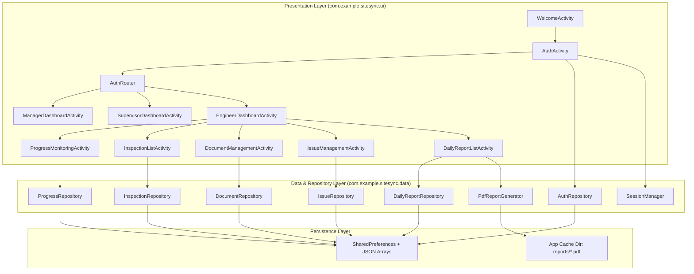

# SiteSync: Comprehensive Architecture, System Design & Codebase Specification

---

## 1. Executive Summary & Vision

**SiteSync** is an enterprise-grade, offline-first Android application engineered for construction site telemetry, quality assurance, field resource tracking, drawing version control, and cross-functional team collaboration. 

In large-scale modern construction (commercial towers, infrastructure, residential complexes), a communication gap frequently exists between field engineers executing physical pours, inspectors enforcing structural codes, site supervisors overseeing daily labor, and project managers allocating multi-million dollar budgets. **SiteSync** bridges this divide by providing role-specialized mobile interfaces backed by an audit-ready, offline-first local data store with instant PDF dispatch.

```
       ┌────────────────────────────────────────────────────────┐
       │                SiteSync Core Platform                  │
       └───────────────────────────┬────────────────────────────┘
                                   │
         ┌─────────────────────────┼─────────────────────────┐
         ▼                         ▼                         ▼
┌──────────────────┐      ┌──────────────────┐      ┌──────────────────┐
│  Project Manager │      │ Site Supervisor  │      │  Field Engineer  │
│    Dashboard     │      │    Dashboard     │      │  Control Center  │
└──────────────────┘      └──────────────────┘      └────────┬─────────┘
                                                             │
         ┌───────────────────┬───────────────────┬───────────┴───────────┬───────────────────┐
         ▼                   ▼                   ▼                       ▼                   ▼
┌─────────────────┐ ┌─────────────────┐ ┌─────────────────┐     ┌─────────────────┐ ┌─────────────────┐
│ Module 1:       │ │ Module 2:       │ │ Module 3:       │     │ Module 4:       │ │ Module 5:       │
│ Site Progress   │ │ QA/QC Site      │ │ Drawings & CAD  │     │ Technical Issue │ │ Daily Site      │
│ Monitoring      │ │ Inspections     │ │ Revisions Hub   │     │ & RFI Hub       │ │ Reports (DSR)   │
└─────────────────┘ └─────────────────┘ └─────────────────┘     └─────────────────┘ └─────────────────┘
```

---

## 2. Technical Stack & Environment

| Layer | Technology | Specification / Details |
|---|---|---|
| **Platform** | Android OS | Native Android (Java 8) |
| **SDK Levels** | Min SDK: 26 (Android 8.0 Oreo)<br>Target SDK: 32 (Android 12L)<br>Compile SDK: 32 | Covers ~95%+ of active modern Android devices |
| **UI Framework** | Google Material Design Components 1.7.0 | Material 3 Cards, Extended FABs, Choice Chips, Outlined Inputs |
| **View Binding** | Android Gradle ViewBinding (`viewBinding = true`) | Type-safe, null-safe UI binding eliminating `findViewById` overhead |
| **Local Storage** | Zero-dependency JSON Serialization | Android `SharedPreferences` + `org.json.JSONObject`/`JSONArray` |
| **Document Engine** | Native Android `PdfDocument` | Custom vector rendering of A4 PDF Daily Reports |
| **Sharing Engine** | AndroidX `FileProvider` (`res/xml/file_paths.xml`) | Secure scoped URI grant via `Intent.ACTION_SEND` |
| **Photo Attachment** | `ActivityResultContracts.GetContent()` | Standard scoped storage picker requiring no invasive runtime storage permissions |
| **Design Language** | Construction-grade industrial palette | Charcoal Navy `#1A2530`, Safety Gold `#F59E0B`, Safety Blue `#2563EB`, Forest Green `#16A34A`, Crimson `#DC2626` |

---

## 3. High-Level Architecture & Design Patterns

SiteSync adopts an offline-first **Repository Pattern** decoupled from UI activities via type-safe ViewBinding.



### Architectural Principles:
1. **Zero External Dependency Persistence**: Instead of bundling heavy relational databases or requiring constant cloud network availability, SiteSync uses atomic JSON serialization saved into `SharedPreferences`. All repositories pre-seed realistic construction projects (Metro Central Tower, Skyline Business Park, Riverside Residences) on first launch.
2. **Offline Resilience**: In remote job sites (deep foundation pits, basements, steel-frame high-rises), internet connectivity is intermittent. SiteSync runs 100% offline with zero stalls or network exceptions.
3. **Role-Based Encapsulation**: Each persona (Project Manager, Site Supervisor, Field Engineer) has a dedicated entry gateway, distinct permissions, and relevant telemetry metrics.

---

## 4. Role-Based Access Control (RBAC) & Authentication

### User Roles (`com.example.sitesync.models.Role`)
1. **`PROJECT_MANAGER`** (Level 1): Executive oversight, milestone schedules, financial allocations, Daily Site Report review.
2. **`SITE_SUPERVISOR`** (Level 2): Ground execution, trade subcontractor coordination, health & safety enforcement.
3. **`ENGINEER`** (Level 3): Structural telemetry, QA/QC digital checklists, CAD blueprint versioning, RFIs, and daily progress compiling.

### Authentication Flow
1. **Welcome Screen ([`WelcomeActivity.java`](file:///C:/Users/User/AndroidStudioProjects/SiteSync/app/src/main/java/com/example/sitesync/ui/WelcomeActivity.java))**:
   - Presents 3 interactive role selection cards with badge indicators.
   - Tapping any role automatically passes the chosen role enum to the Auth Screen via Intent extras.
2. **Auth Screen ([`AuthActivity.java`](file:///C:/Users/User/AndroidStudioProjects/SiteSync/app/src/main/java/com/example/sitesync/ui/AuthActivity.java))**:
   - **Tab 1: Log In**:
     - *Method A*: User ID + Password.
     - *Method B*: Phone Number + OTP verification (simulated with instant verification).
   - **Tab 2: Sign Up / Create ID**:
     - Input fields: Full Name, Country, Email, Phone Number, Desired User ID, and Password.
     - Performs email regex verification, non-empty validation, and role assignment.
3. **Intelligent Router ([`AuthRouter.java`](file:///C:/Users/User/AndroidStudioProjects/SiteSync/app/src/main/java/com/example/sitesync/ui/AuthRouter.java))**:
   - Clean routing class mapping `Role` to designated dashboard activities:
     - `Role.PROJECT_MANAGER` ➔ [`ManagerDashboardActivity.java`](file:///C:/Users/User/AndroidStudioProjects/SiteSync/app/src/main/java/com/example/sitesync/ui/ManagerDashboardActivity.java)
     - `Role.SITE_SUPERVISOR` ➔ [`SupervisorDashboardActivity.java`](file:///C:/Users/User/AndroidStudioProjects/SiteSync/app/src/main/java/com/example/sitesync/ui/SupervisorDashboardActivity.java)
     - `Role.ENGINEER` ➔ [`EngineerDashboardActivity.java`](file:///C:/Users/User/AndroidStudioProjects/SiteSync/app/src/main/java/com/example/sitesync/ui/EngineerDashboardActivity.java)
4. **Preloaded Test Credentials**:
   - `manager` / `manager123` ➔ Marcus Vance (Project Director)
   - `supervisor` / `super123` ➔ David Bautista (Chief Site Supervisor)
   - `engineer` / `eng123` ➔ Elena Rostova (Lead Field Engineer)

---

## 5. Engineer Module: Detailed Breakdown

The Engineer Module ([`EngineerDashboardActivity.java`](file:///C:/Users/User/AndroidStudioProjects/SiteSync/app/src/main/java/com/example/sitesync/ui/EngineerDashboardActivity.java)) is the operational powerhouse of SiteSync. It features **5 comprehensive sub-systems**:

```
Engineer Control Center
 ├── Module 1: Site Progress Monitoring
 ├── Module 2: Site Inspection & Quality Control (QA/QC)
 ├── Module 3: Drawings & Document Management (CAD Revisions)
 ├── Module 4: Technical Issues & RFI Management
 └── Module 5: Daily Site Reports (DSR) & PDF Dispatch
```

---

### Module 1: Site Progress Monitoring

```
[Progress Monitoring Hub] ──> [Task Details] ──> [Update Progress % & Remarks]
                          └──> [+ Add New Construction Milestone]
```

- **Objective**: Track milestone execution percentages, status lifecycles, and chronological audit histories.
- **Key Features**:
  - Construction Activities tracking: Project Name, Activity Name, Physical Location, Progress Percentage (0–100%), and Status (`Pending`, `In Progress`, `Completed`).
  - Progress Update workflow: Engineers can update completion slider/percentage, add progress remarks, and attach site photos.
  - Complete chronological audit log ([`ProgressHistoryAdapter.java`](file:///C:/Users/User/AndroidStudioProjects/SiteSync/app/src/main/java/com/example/sitesync/ui/ProgressHistoryAdapter.java)) preserving historical milestone logs.
- **Files**:
  - Model: [`ConstructionActivity.java`](file:///C:/Users/User/AndroidStudioProjects/SiteSync/app/src/main/java/com/example/sitesync/models/ConstructionActivity.java), [`ProgressLog.java`](file:///C:/Users/User/AndroidStudioProjects/SiteSync/app/src/main/java/com/example/sitesync/models/ProgressLog.java)
  - Data: [`ProgressRepository.java`](file:///C:/Users/User/AndroidStudioProjects/SiteSync/app/src/main/java/com/example/sitesync/data/ProgressRepository.java)
  - UI: [`ProgressMonitoringActivity.java`](file:///C:/Users/User/AndroidStudioProjects/SiteSync/app/src/main/java/com/example/sitesync/ui/ProgressMonitoringActivity.java), [`ProgressDetailActivity.java`](file:///C:/Users/User/AndroidStudioProjects/SiteSync/app/src/main/java/com/example/sitesync/ui/ProgressDetailActivity.java), [`UpdateProgressActivity.java`](file:///C:/Users/User/AndroidStudioProjects/SiteSync/app/src/main/java/com/example/sitesync/ui/UpdateProgressActivity.java), [`AddActivityActivity.java`](file:///C:/Users/User/AndroidStudioProjects/SiteSync/app/src/main/java/com/example/sitesync/ui/AddActivityActivity.java)

---

### Module 2: Site Inspection & Quality Control (QA/QC)

```
[QA/QC Inspection Hub] ──> [Create Inspection with Digital Checklist]
                       ──> [Inspection Details & Photo Review]
                       ──> [Trigger Re-Inspection Lifecycle]
```

- **Objective**: Execute digital structural and MEP quality audits with interactive verification checklists.
- **Key Features**:
  - Interactive checklists for rebar clearance, concrete slump, MEP conduit routing, formwork stability, and waterproofing.
  - Inspection Status: `Passed` (Green), `Failed` (Red), `Pending` (Amber).
  - Photographic evidence attachment.
  - **Full Re-Inspection Engine** ([`ReInspectionActivity.java`](file:///C:/Users/User/AndroidStudioProjects/SiteSync/app/src/main/java/com/example/sitesync/ui/ReInspectionActivity.java)): Allows failed audits to be re-tested, storing complete multi-attempt audit trails without overwriting original records.
- **Files**:
  - Model: [`SiteInspection.java`](file:///C:/Users/User/AndroidStudioProjects/SiteSync/app/src/main/java/com/example/sitesync/models/SiteInspection.java), [`InspectionChecklistItem.java`](file:///C:/Users/User/AndroidStudioProjects/SiteSync/app/src/main/java/com/example/sitesync/models/InspectionChecklistItem.java), [`InspectionRecord.java`](file:///C:/Users/User/AndroidStudioProjects/SiteSync/app/src/main/java/com/example/sitesync/models/InspectionRecord.java)
  - Data: [`InspectionRepository.java`](file:///C:/Users/User/AndroidStudioProjects/SiteSync/app/src/main/java/com/example/sitesync/data/InspectionRepository.java)
  - UI: [`InspectionListActivity.java`](file:///C:/Users/User/AndroidStudioProjects/SiteSync/app/src/main/java/com/example/sitesync/ui/InspectionListActivity.java), [`CreateInspectionActivity.java`](file:///C:/Users/User/AndroidStudioProjects/SiteSync/app/src/main/java/com/example/sitesync/ui/CreateInspectionActivity.java), [`InspectionDetailActivity.java`](file:///C:/Users/User/AndroidStudioProjects/SiteSync/app/src/main/java/com/example/sitesync/ui/InspectionDetailActivity.java), [`ReInspectionActivity.java`](file:///C:/Users/User/AndroidStudioProjects/SiteSync/app/src/main/java/com/example/sitesync/ui/ReInspectionActivity.java)

---

### Module 3: Drawings & Document Management

```
[CAD Blueprints Hub] ──> [Category Filters: Arch, Struct, Elec, Plumb]
                     ──> [Revision Tree & Latest Approved Tag]
                     ──> [Integrated PDF Viewer]
                     ──> [Upload Submittal Drawing]
```

- **Objective**: Maintain up-to-date construction drawings across all engineering disciplines, preventing costly on-site errors from outdated plans.
- **Key Features**:
  - Disciplines: `Architectural`, `Structural`, `Electrical`, `Plumbing`.
  - Multi-revision tracking (`Rev 1.0`, `Rev 2.1`, `Rev 3.0`) with visual identification of the **"Latest Approved Revision"**.
  - Built-in PDF Viewing engine ([`PdfViewerActivity.java`](file:///C:/Users/User/AndroidStudioProjects/SiteSync/app/src/main/java/com/example/sitesync/ui/PdfViewerActivity.java)) with full-screen zoom, pan, and page rendering.
  - Submittal upload form ([`UploadDocumentActivity.java`](file:///C:/Users/User/AndroidStudioProjects/SiteSync/app/src/main/java/com/example/sitesync/ui/UploadDocumentActivity.java)) with file size, revision notes, and approval tags.
- **Files**:
  - Model: [`SiteDocument.java`](file:///C:/Users/User/AndroidStudioProjects/SiteSync/app/src/main/java/com/example/sitesync/models/SiteDocument.java), [`DocumentRevision.java`](file:///C:/Users/User/AndroidStudioProjects/SiteSync/app/src/main/java/com/example/sitesync/models/DocumentRevision.java)
  - Data: [`DocumentRepository.java`](file:///C:/Users/User/AndroidStudioProjects/SiteSync/app/src/main/java/com/example/sitesync/data/DocumentRepository.java)
  - UI: [`DocumentManagementActivity.java`](file:///C:/Users/User/AndroidStudioProjects/SiteSync/app/src/main/java/com/example/sitesync/ui/DocumentManagementActivity.java), [`DocumentDetailActivity.java`](file:///C:/Users/User/AndroidStudioProjects/SiteSync/app/src/main/java/com/example/sitesync/ui/DocumentDetailActivity.java), [`UploadDocumentActivity.java`](file:///C:/Users/User/AndroidStudioProjects/SiteSync/app/src/main/java/com/example/sitesync/ui/UploadDocumentActivity.java), [`PdfViewerActivity.java`](file:///C:/Users/User/AndroidStudioProjects/SiteSync/app/src/main/java/com/example/sitesync/ui/PdfViewerActivity.java)

---

### Module 4: Technical Issues & RFI Management

```
[Technical Issue / RFI Hub] ──> [Raise Clarification / Defect]
                             ──> [Dynamic Status Stepper Dialog]
                             ──> [Live Discussion Reply Thread]
                             ──> [Audit History Timeline]
```

- **Objective**: Manage site clarifications (RFIs), blueprint discrepancies, and beam/duct clashing resolutions between field teams and lead consultants.
- **Key Features**:
  - Priority Spectrum: `High` (Red), `Medium` (Orange), `Low` (Blue).
  - Status Lifecycle: `Open` ➔ `Assigned` ➔ `In Review` ➔ `Resolved` ➔ `Closed`.
  - Discussion Stream: Multi-party technical replies with author role badges and timestamps.
  - Real-time search by Title, Description, Project, Location, or Assigned Engineer.
  - Live KPI overview cards (Total RFIs, High Priority, In Review, Resolved).
- **Files**:
  - Model: [`TechnicalIssue.java`](file:///C:/Users/User/AndroidStudioProjects/SiteSync/app/src/main/java/com/example/sitesync/models/TechnicalIssue.java), [`IssueComment.java`](file:///C:/Users/User/AndroidStudioProjects/SiteSync/app/src/main/java/com/example/sitesync/models/IssueComment.java), [`IssueHistoryLog.java`](file:///C:/Users/User/AndroidStudioProjects/SiteSync/app/src/main/java/com/example/sitesync/models/IssueHistoryLog.java)
  - Data: [`IssueRepository.java`](file:///C:/Users/User/AndroidStudioProjects/SiteSync/app/src/main/java/com/example/sitesync/data/IssueRepository.java)
  - UI: [`IssueManagementActivity.java`](file:///C:/Users/User/AndroidStudioProjects/SiteSync/app/src/main/java/com/example/sitesync/ui/IssueManagementActivity.java), [`CreateIssueActivity.java`](file:///C:/Users/User/AndroidStudioProjects/SiteSync/app/src/main/java/com/example/sitesync/ui/CreateIssueActivity.java), [`IssueDetailActivity.java`](file:///C:/Users/User/AndroidStudioProjects/SiteSync/app/src/main/java/com/example/sitesync/ui/IssueDetailActivity.java)

---

### Module 5: Daily Site Reports (DSR) & PDF Dispatch

```
[Daily Reports Hub] ──> [5-Section Report Form (Draft vs. Submit)]
                    ──> [Full Report Inspection & Photos]
                    ──> [Native A4 PDF Engine (PdfReportGenerator)]
                    ──> [FileProvider PM Share via ActionSend]
```

- **Objective**: Compile daily site logs of works, labor, materials, equipment, and weather hindrances, and dispatch official signed PDF reports to the Project Manager.
- **Key Features**:
  - Comprehensive 5-Section Data Model:
    1. *General Site Info*: Project Name, Report Date, Weather Conditions.
    2. *Work Completed*: Physical accomplishments across grid lines.
    3. *Resource Deployment*: Labor Headcounts, Materials Consumed, Equipment/Machinery Deployed.
    4. *Hindrances & Tomorrow's Plan*: Weather/breakdown delays, next-day targets.
    5. *Site Photo Evidence*: Attached photo with preview and remove button.
  - **Save Draft vs. Submit**: Allows engineers to record details incrementally as shifts progress, with one-tap final submission and timestamping.
  - **Native A4 PDF Engine ([`PdfReportGenerator.java`](file:///C:/Users/User/AndroidStudioProjects/SiteSync/app/src/main/java/com/example/sitesync/data/PdfReportGenerator.java))**:
    - Generates a branded, publication-ready vector PDF document using standard Android `PdfDocument`.
    - Features official headers, project metadata boxes, wrapped multi-line section typography, and digital verification blocks.
  - **Direct PM Sharing**: Configured with AndroidX `FileProvider` (`res/xml/file_paths.xml`) and `Intent.ACTION_SEND` to share PDFs via Email, WhatsApp, or cloud storage directly to Project Managers.
- **Files**:
  - Model: [`DailySiteReport.java`](file:///C:/Users/User/AndroidStudioProjects/SiteSync/app/src/main/java/com/example/sitesync/models/DailySiteReport.java)
  - Data: [`DailyReportRepository.java`](file:///C:/Users/User/AndroidStudioProjects/SiteSync/app/src/main/java/com/example/sitesync/data/DailyReportRepository.java), [`PdfReportGenerator.java`](file:///C:/Users/User/AndroidStudioProjects/SiteSync/app/src/main/java/com/example/sitesync/data/PdfReportGenerator.java)
  - UI: [`DailyReportListActivity.java`](file:///C:/Users/User/AndroidStudioProjects/SiteSync/app/src/main/java/com/example/sitesync/ui/DailyReportListActivity.java), [`CreateDailyReportActivity.java`](file:///C:/Users/User/AndroidStudioProjects/SiteSync/app/src/main/java/com/example/sitesync/ui/CreateDailyReportActivity.java), [`DailyReportDetailActivity.java`](file:///C:/Users/User/AndroidStudioProjects/SiteSync/app/src/main/java/com/example/sitesync/ui/DailyReportDetailActivity.java)

---

## 6. Complete Codebase Directory & File Inventory

Below is an exhaustive index of all primary source files in the project:

### 1. Presentation Activities (`com.example.sitesync.ui`)
| File | Lines | Responsibility |
|---|---|---|
| [`WelcomeActivity.java`](file:///C:/Users/User/AndroidStudioProjects/SiteSync/app/src/main/java/com/example/sitesync/ui/WelcomeActivity.java) | ~60 | Entry screen with 3 interactive role cards passing selected role via Intent |
| [`AuthActivity.java`](file:///C:/Users/User/AndroidStudioProjects/SiteSync/app/src/main/java/com/example/sitesync/ui/AuthActivity.java) | ~320 | Dual-mode authentication (Sign In with 6 fields, Log In with User ID or Phone+OTP) |
| [`AuthRouter.java`](file:///C:/Users/User/AndroidStudioProjects/SiteSync/app/src/main/java/com/example/sitesync/ui/AuthRouter.java) | ~50 | Decoupled routing factory directing users to PM, Supervisor, or Engineer dashboards |
| [`ManagerDashboardActivity.java`](file:///C:/Users/User/AndroidStudioProjects/SiteSync/app/src/main/java/com/example/sitesync/ui/ManagerDashboardActivity.java) | ~65 | Project Manager executive control center |
| [`SupervisorDashboardActivity.java`](file:///C:/Users/User/AndroidStudioProjects/SiteSync/app/src/main/java/com/example/sitesync/ui/SupervisorDashboardActivity.java) | ~65 | Site Supervisor field execution dashboard |
| [`EngineerDashboardActivity.java`](file:///C:/Users/User/AndroidStudioProjects/SiteSync/app/src/main/java/com/example/sitesync/ui/EngineerDashboardActivity.java) | ~200 | Hub integrating all 5 engineering modules with real-time KPI badge updates |
| [`ProgressMonitoringActivity.java`](file:///C:/Users/User/AndroidStudioProjects/SiteSync/app/src/main/java/com/example/sitesync/ui/ProgressMonitoringActivity.java) | ~140 | Milestone list with status filters, search, and activity creation |
| [`ProgressDetailActivity.java`](file:///C:/Users/User/AndroidStudioProjects/SiteSync/app/src/main/java/com/example/sitesync/ui/ProgressDetailActivity.java) | ~160 | Milestone inspection, progress bar, remarks, and chronological audit trail |
| [`UpdateProgressActivity.java`](file:///C:/Users/User/AndroidStudioProjects/SiteSync/app/src/main/java/com/example/sitesync/ui/UpdateProgressActivity.java) | ~180 | Progress slider (0–100%), status dropdown, photo evidence attachment |
| [`AddActivityActivity.java`](file:///C:/Users/User/AndroidStudioProjects/SiteSync/app/src/main/java/com/example/sitesync/ui/AddActivityActivity.java) | ~110 | Creates new construction milestone activities with validation |
| [`InspectionListActivity.java`](file:///C:/Users/User/AndroidStudioProjects/SiteSync/app/src/main/java/com/example/sitesync/ui/InspectionListActivity.java) | ~140 | QA/QC list with filter chips (`All`, `Passed`, `Failed`, `Pending`) |
| [`CreateInspectionActivity.java`](file:///C:/Users/User/AndroidStudioProjects/SiteSync/app/src/main/java/com/example/sitesync/ui/CreateInspectionActivity.java) | ~230 | Audit creation with interactive digital verification checklist items |
| [`InspectionDetailActivity.java`](file:///C:/Users/User/AndroidStudioProjects/SiteSync/app/src/main/java/com/example/sitesync/ui/InspectionDetailActivity.java) | ~170 | Inspection record viewer with checklist verification results and re-inspection triggers |
| [`ReInspectionActivity.java`](file:///C:/Users/User/AndroidStudioProjects/SiteSync/app/src/main/java/com/example/sitesync/ui/ReInspectionActivity.java) | ~170 | Re-audit workflow recording subsequent attempts and status reversals |
| [`DocumentManagementActivity.java`](file:///C:/Users/User/AndroidStudioProjects/SiteSync/app/src/main/java/com/example/sitesync/ui/DocumentManagementActivity.java) | ~140 | Category filtering for Arch, Struct, Elec, Plumb drawings with search |
| [`DocumentDetailActivity.java`](file:///C:/Users/User/AndroidStudioProjects/SiteSync/app/src/main/java/com/example/sitesync/ui/DocumentDetailActivity.java) | ~160 | Drawing specifications, revision list, latest approved revision badge |
| [`UploadDocumentActivity.java`](file:///C:/Users/User/AndroidStudioProjects/SiteSync/app/src/main/java/com/example/sitesync/ui/UploadDocumentActivity.java) | ~210 | CAD plan and document submittal uploader |
| [`PdfViewerActivity.java`](file:///C:/Users/User/AndroidStudioProjects/SiteSync/app/src/main/java/com/example/sitesync/ui/PdfViewerActivity.java) | ~110 | Built-in PDF renderer with zoom controls and page counter |
| [`IssueManagementActivity.java`](file:///C:/Users/User/AndroidStudioProjects/SiteSync/app/src/main/java/com/example/sitesync/ui/IssueManagementActivity.java) | ~190 | RFI list, KPI stats, priority filters, and search watcher |
| [`CreateIssueActivity.java`](file:///C:/Users/User/AndroidStudioProjects/SiteSync/app/src/main/java/com/example/sitesync/ui/CreateIssueActivity.java) | ~170 | Clarification/RFI submission form with photo picker |
| [`IssueDetailActivity.java`](file:///C:/Users/User/AndroidStudioProjects/SiteSync/app/src/main/java/com/example/sitesync/ui/IssueDetailActivity.java) | ~250 | Status dialog, multi-party comment thread, and timeline audit logs |
| [`DailyReportListActivity.java`](file:///C:/Users/User/AndroidStudioProjects/SiteSync/app/src/main/java/com/example/sitesync/ui/DailyReportListActivity.java) | ~180 | Daily site report list, KPI stats, drafts filter, quick PDF share |
| [`CreateDailyReportActivity.java`](file:///C:/Users/User/AndroidStudioProjects/SiteSync/app/src/main/java/com/example/sitesync/ui/CreateDailyReportActivity.java) | ~250 | 5-section daily construction report form supporting Drafts and Submission |
| [`DailyReportDetailActivity.java`](file:///C:/Users/User/AndroidStudioProjects/SiteSync/app/src/main/java/com/example/sitesync/ui/DailyReportDetailActivity.java) | ~140 | Full DSR breakdown, photo evidence, Edit button, and PM PDF dispatch |

### 2. Adapters (`com.example.sitesync.ui`)
- [`ConstructionActivityAdapter.java`](file:///C:/Users/User/AndroidStudioProjects/SiteSync/app/src/main/java/com/example/sitesync/ui/ConstructionActivityAdapter.java): Milestone cards with progress bars and status pills.
- [`ProgressHistoryAdapter.java`](file:///C:/Users/User/AndroidStudioProjects/SiteSync/app/src/main/java/com/example/sitesync/ui/ProgressHistoryAdapter.java): Timeline indicator for progress updates.
- [`SiteInspectionAdapter.java`](file:///C:/Users/User/AndroidStudioProjects/SiteSync/app/src/main/java/com/example/sitesync/ui/SiteInspectionAdapter.java): Inspection cards with pass/fail badges.
- [`InspectionChecklistAdapter.java`](file:///C:/Users/User/AndroidStudioProjects/SiteSync/app/src/main/java/com/example/sitesync/ui/InspectionChecklistAdapter.java): Checkable or read-only digital checklist rows.
- [`InspectionHistoryAdapter.java`](file:///C:/Users/User/AndroidStudioProjects/SiteSync/app/src/main/java/com/example/sitesync/ui/InspectionHistoryAdapter.java): Multi-attempt audit history rows.
- [`SiteDocumentAdapter.java`](file:///C:/Users/User/AndroidStudioProjects/SiteSync/app/src/main/java/com/example/sitesync/ui/SiteDocumentAdapter.java): Categorized blueprint cards with revision pill.
- [`DocumentRevisionAdapter.java`](file:///C:/Users/User/AndroidStudioProjects/SiteSync/app/src/main/java/com/example/sitesync/ui/DocumentRevisionAdapter.java): Revision history rows highlighting the latest approved revision.
- [`TechnicalIssueAdapter.java`](file:///C:/Users/User/AndroidStudioProjects/SiteSync/app/src/main/java/com/example/sitesync/ui/TechnicalIssueAdapter.java): Issue cards color-coded by Priority (`High`, `Med`, `Low`) and Status.
- [`IssueCommentAdapter.java`](file:///C:/Users/User/AndroidStudioProjects/SiteSync/app/src/main/java/com/example/sitesync/ui/IssueCommentAdapter.java): Discussion comments with author roles.
- [`IssueHistoryLogAdapter.java`](file:///C:/Users/User/AndroidStudioProjects/SiteSync/app/src/main/java/com/example/sitesync/ui/IssueHistoryLogAdapter.java): Audit log timeline for RFI lifecycle changes.
- [`DailySiteReportAdapter.java`](file:///C:/Users/User/AndroidStudioProjects/SiteSync/app/src/main/java/com/example/sitesync/ui/DailySiteReportAdapter.java): Daily report cards with weather, manpower snippet, and quick PDF share.

### 3. Models (`com.example.sitesync.models`)
- [`User.java`](file:///C:/Users/User/AndroidStudioProjects/SiteSync/app/src/main/java/com/example/sitesync/models/User.java): Authenticated user entity with credentials and role.
- [`Role.java`](file:///C:/Users/User/AndroidStudioProjects/SiteSync/app/src/main/java/com/example/sitesync/models/Role.java): Role enum with display labels and badge colors.
- [`ConstructionActivity.java`](file:///C:/Users/User/AndroidStudioProjects/SiteSync/app/src/main/java/com/example/sitesync/models/ConstructionActivity.java): Progress task entity with percentage, photos, and audit logs.
- [`ProgressLog.java`](file:///C:/Users/User/AndroidStudioProjects/SiteSync/app/src/main/java/com/example/sitesync/models/ProgressLog.java): Milestone delta update model.
- [`SiteInspection.java`](file:///C:/Users/User/AndroidStudioProjects/SiteSync/app/src/main/java/com/example/sitesync/models/SiteInspection.java): QA audit entity with checklists and re-inspection attempts.
- [`InspectionChecklistItem.java`](file:///C:/Users/User/AndroidStudioProjects/SiteSync/app/src/main/java/com/example/sitesync/models/InspectionChecklistItem.java): Digital checklist item with toggle state.
- [`InspectionRecord.java`](file:///C:/Users/User/AndroidStudioProjects/SiteSync/app/src/main/java/com/example/sitesync/models/InspectionRecord.java): Attempt record for re-inspection history.
- [`SiteDocument.java`](file:///C:/Users/User/AndroidStudioProjects/SiteSync/app/src/main/java/com/example/sitesync/models/SiteDocument.java): Drawing entity with category, discipline, and revisions.
- [`DocumentRevision.java`](file:///C:/Users/User/AndroidStudioProjects/SiteSync/app/src/main/java/com/example/sitesync/models/DocumentRevision.java): Individual drawing revision metadata.
- [`TechnicalIssue.java`](file:///C:/Users/User/AndroidStudioProjects/SiteSync/app/src/main/java/com/example/sitesync/models/TechnicalIssue.java): RFI model with priority, status, comments, and audit logs.
- [`IssueComment.java`](file:///C:/Users/User/AndroidStudioProjects/SiteSync/app/src/main/java/com/example/sitesync/models/IssueComment.java): Technical reply model.
- [`IssueHistoryLog.java`](file:///C:/Users/User/AndroidStudioProjects/SiteSync/app/src/main/java/com/example/sitesync/models/IssueHistoryLog.java): Lifecycle change log entry.
- [`DailySiteReport.java`](file:///C:/Users/User/AndroidStudioProjects/SiteSync/app/src/main/java/com/example/sitesync/models/DailySiteReport.java): DSR model capturing work, labor, materials, equipment, problems, photos, and plans.

### 4. Data Repositories & Utilities (`com.example.sitesync.data`)
- [`AuthRepository.java`](file:///C:/Users/User/AndroidStudioProjects/SiteSync/app/src/main/java/com/example/sitesync/data/AuthRepository.java): Manages credentials, sign-ups, and password/OTP authentication.
- [`SessionManager.java`](file:///C:/Users/User/AndroidStudioProjects/SiteSync/app/src/main/java/com/example/sitesync/data/SessionManager.java): Tracks active session tokens and logged-in user profile.
- [`ProgressRepository.java`](file:///C:/Users/User/AndroidStudioProjects/SiteSync/app/src/main/java/com/example/sitesync/data/ProgressRepository.java): Offline persistence for milestone progress and historical updates.
- [`InspectionRepository.java`](file:///C:/Users/User/AndroidStudioProjects/SiteSync/app/src/main/java/com/example/sitesync/data/InspectionRepository.java): Persistence for QA/QC inspections and re-inspections.
- [`DocumentRepository.java`](file:///C:/Users/User/AndroidStudioProjects/SiteSync/app/src/main/java/com/example/sitesync/data/DocumentRepository.java): Local storage for architectural/engineering drawings and revision histories.
- [`IssueRepository.java`](file:///C:/Users/User/AndroidStudioProjects/SiteSync/app/src/main/java/com/example/sitesync/data/IssueRepository.java): Local storage for technical issues, RFIs, comments, and status lifecycles.
- [`DailyReportRepository.java`](file:///C:/Users/User/AndroidStudioProjects/SiteSync/app/src/main/java/com/example/sitesync/data/DailyReportRepository.java): Offline persistence for daily construction reports (drafts and submitted).
- [`PdfReportGenerator.java`](file:///C:/Users/User/AndroidStudioProjects/SiteSync/app/src/main/java/com/example/sitesync/data/PdfReportGenerator.java): Custom A4 PDF rendering engine with FileProvider PM sharing integration.

---

## 7. App Manifest Configuration & Permissions

[`AndroidManifest.xml`](file:///C:/Users/User/AndroidStudioProjects/SiteSync/app/src/main/AndroidManifest.xml) registers all activities and security providers:
- **Launcher Entry**: `.ui.WelcomeActivity` configured with `android.intent.action.MAIN` and `android.intent.category.LAUNCHER`.
- **Keyboard Handling**: All input activities (`AuthActivity`, `CreateDailyReportActivity`, `CreateIssueActivity`, `UploadDocumentActivity`, etc.) use `android:windowSoftInputMode="adjustResize"` to ensure smooth keyboard transitions.
- **Secure File Provider**:
  ```xml
  <provider
      android:name="androidx.core.content.FileProvider"
      android:authorities="${applicationId}.fileprovider"
      android:exported="false"
      android:grantUriPermissions="true">
      <meta-data
          android:name="android.support.FILE_PROVIDER_PATHS"
          android:resource="@xml/file_paths" />
  </provider>
  ```

---

## 8. Summary of What Makes SiteSync Unique

1. **Complete Field-to-Executive Loop**: From pouring concrete to generating signed PDFs for the Project Director, the entire workflow is covered.
2. **Zero Bloat & Zero Breakage**: Built on core Android SDK tools (`PdfDocument`, `FileProvider`, `ActivityResultContracts`, `ViewBinding`) without cumbersome third-party frameworks.
3. **Resilient Local Storage**: Operates reliably in basements, rural sites, and shielded concrete tunnels with instantaneous response times.
4. **Professional Construction UX**: Clean industrial color scheme, accessible typography, distinct status color-coding, and cohesive card-based layouts.
